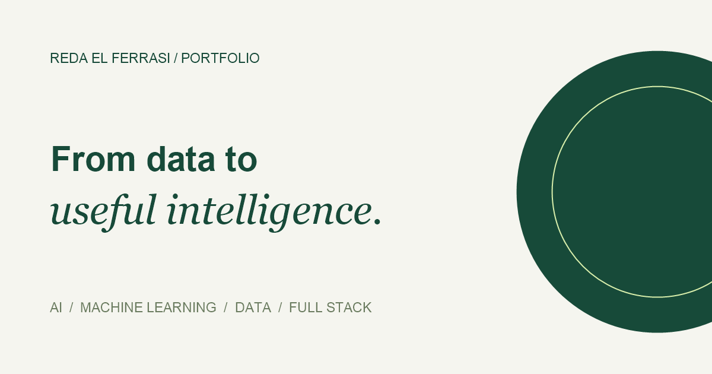
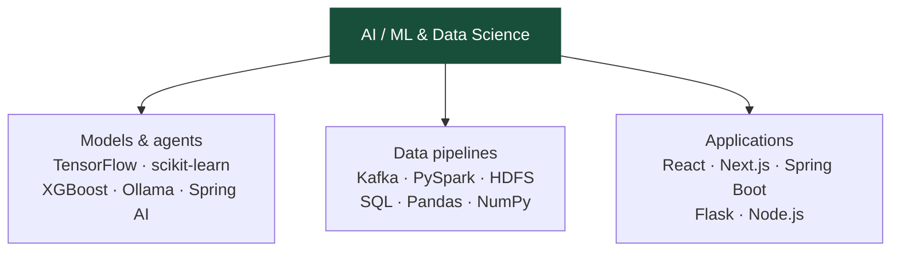
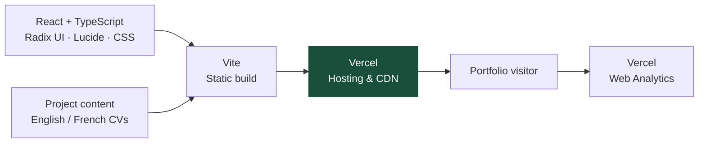

# Reda El Ferrasi · Portfolio

  <strong>AI · Machine Learning · Data Science</strong> 
  Full-stack engineering to turn ideas into applications.

  
  

Explore my projects, interactive architecture walkthroughs, experience, and English/French CVs on **[reda-elferrasi.vercel.app](https://reda-elferrasi.vercel.app/)**.

## Built with

**React · TypeScript · Vite · CSS · Vercel · Vitest · Git**

Radix UI powers accessible dialogs, Lucide provides icons, and Vercel Web Analytics tracks visits. The interface includes project search and filters, English/French switching, responsive layouts, and reduced-motion support.

## Tools I work with

These technologies come from the projects and experience featured in the portfolio.

| Focus                      | Technologies                                                                                                                                                                                                          |
| -------------------------- | --------------------------------------------------------------------------------------------------------------------------------------------------------------------------------------------------------------------- |
| **AI & machine learning**  |  Python · TensorFlow/Keras · scikit-learn · XGBoost · Ollama · Spring AI      |
| **Data & infrastructure**  |  Kafka · PySpark · HDFS · SQL · Pandas · NumPy · PostgreSQL · MongoDB · Docker       |
| **Full-stack development** |  React · Next.js · TypeScript · Java · Spring Boot · Flask · Node.js · REST APIs · WebSocket |

## Selected projects

| Project                                                | What it explores                               | Main technologies                                       |
| ------------------------------------------------------ | ---------------------------------------------- | ------------------------------------------------------- |
| [TalentAI](https://github.com/redaelfer/TalentAI)      | AI-assisted recruitment and candidate matching | React · Spring Boot · Spring AI · Ollama · PostgreSQL   |
| [RetinaScan](https://github.com/redaelfer/RetinaScan)  | Academic retinal-image classification          | TensorFlow · MobileNetV2 · Flask · React · Spring Boot  |
| [APT Detection](https://github.com/redaelfer/NosqlAPT) | Machine learning for security-log analysis     | Python · XGBoost · scikit-learn · TensorFlow · Logstash |
| [BigData](https://github.com/redaelfer/BigData)        | Streaming events from ingestion to storage     | Kafka · PySpark · HDFS · Python · Docker                |
| [AgentFleet](https://github.com/redaelfer/AgentFleet)  | A control interface for containerized agents   | Next.js · TypeScript · Dockerode · PostgreSQL · Redis   |
| [JobOS](https://github.com/redaelfer/JobOS)            | A local workspace for job-search organization  | Node.js · SQLite · Ollama · LaTeX                       |

**[Explore all projects and case studies →](https://reda-elferrasi.vercel.app/#work)**

## How this portfolio is built

---

[CV editing](docs/EDITING-CVS.md) · [Development notes](docs/DEVELOPMENT.md) · [Deployment](docs/VERCEL-DEPLOYMENT.md)
